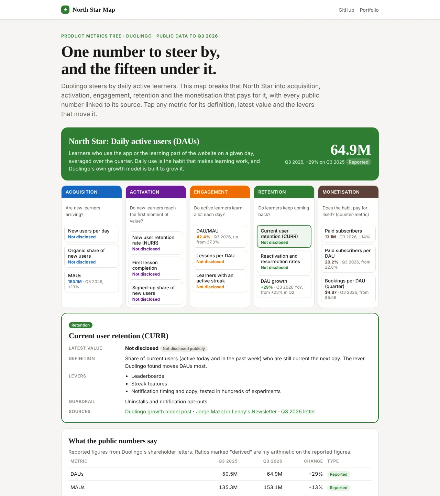

# North Star Map

**An interactive metrics tree for Duolingo, from the North Star down to the levers, with every public number sourced.**

**Current version:** 0.1.0

Live: https://kostasxeras.com/north-star-map/



## The question

A North Star metric is only useful if a team can see what moves it. Most metric trees in PM portfolios are diagrams with made-up numbers. I wanted one built on a real company, with real public numbers, an honest label on everything the company does not disclose, and a working model of how the input metrics drive the North Star. Duolingo is a good case: it publishes daily active users every quarter and has written openly about the growth model behind them.

## Who it is for

- Product managers and interviewers who want to see how a North Star breaks down into input metrics
- Teams building their own metrics tree who want a worked example
- Hiring managers looking at how I think about metrics, counter-metrics and guardrails

## What is inside

- **Metrics tree** with the North Star (DAUs) and 15 metrics under it, in five branches: acquisition, activation, engagement, retention and monetisation
- **Metric detail panel**: definition, latest value, levers, guardrail and sources for each metric
- **Honest labels** on every value: reported, derived from reported figures, or not disclosed publicly
- **Public numbers table**: Q3 2025 against Q3 2026 from Duolingo's shareholder letters, with derived ratios
- **Growth model simulator**: Duolingo's seven user states, nine adjustable transition rates, and the DAU effect of improving each rate by 2%
- **Recommendations**: how I would run this tree if I owned it

## Main findings

Full detail in the [case study](docs/case-study.md).

- **Users are growing faster than payers** (confirmed, derived from reported figures). DAUs rose 29% from Q3 2025 to Q3 2026 while paid subscribers rose 14%. Paid subscribers per DAU fell from 22.8% to 20.2%, and bookings per DAU from $5.58 to $4.87 a quarter. Duolingo says this is a deliberate choice in its Q4 2025 letter: it is giving up bookings in 2026 to improve the free experience and grow users.
- **More of the monthly base shows up daily** (confirmed, derived from reported figures). DAU/MAU rose from 37.3% to 42.4%. Engagement is deepening, not only reach.
- **Current user retention is the biggest lever in a mature habit app** (hypothesis, illustrative model). In my simulator, with my own assumed rates, a 2% improvement in CURR adds about 15% to DAUs after a year, around ten times the next lever. This matches what Duolingo reported from its own model and A/B tests. The rates are mine, not Duolingo's, so the size of the effect is not a finding. The ranking changes when current users are a small share of the base, which the simulator lets you test.

## Data and sources

All figures are public. Reported numbers come from Duolingo's [Q3 2026 shareholder letter](https://www.sec.gov/Archives/edgar/data/0001562088/000162828026069474/q3fy26duolingo9-30x26share.htm) and [Q4 and FY 2025 shareholder letter](https://investors.duolingo.com/static-files/961ce633-3cee-49d0-bd7a-2c63731d45fb). The growth model structure comes from Duolingo's blog post [Meaningful metrics](https://blog.duolingo.com/growth-model-duolingo/) and Jorge Mazal's [article in Lenny's Newsletter](https://www.lennysnewsletter.com/p/how-duolingo-reignited-user-growth). Derived ratios are my arithmetic on reported figures and are labelled as such. The simulator's transition rates are my assumptions, labelled as illustrative on the page. Duolingo is not involved in this project.

## Decisions

- [DAUs as the North Star, with a monetisation counter-metric](docs/decisions/0001-dau-as-north-star.md)
- [Label every value as reported, derived or not disclosed](docs/decisions/0002-label-every-number.md)
- [Rebuild the growth model with illustrative rates](docs/decisions/0003-illustrative-simulator.md)

## How I would measure success

No usage data yet. These are the measures I would track, with targets to set after real use.

| Measure | Definition | Target |
|---|---|---|
| Metric opened | Share of visitors who open at least one metric detail | [target] |
| Simulator used | Share of visitors who change at least one rate | [target] |
| Source clicks | Clicks on source links per visit | [target] |

## What I would do next

1. Add a second company (for example a marketplace) to show how the tree changes with the business model
2. Add quarterly history for DAUs, MAUs and paid subscribers as small charts
3. Let visitors build their own tree for their own product and export it

## My role

I framed the problem, made the product calls and wrote the conclusions. 

## Run it yourself

One HTML page with no build step. Open `index.html` through any local web server, for example `python3 -m http.server`, then go to http://localhost:8000.

## Repo layout

```
index.html               The page
app.css                  Shared base styles
docs/product-brief.md    Problem, users, goals, scope
docs/case-study.md       Approach, decisions, findings, next steps
docs/decisions/          One record per real tradeoff
docs/screenshots/        Desktop and mobile
```
